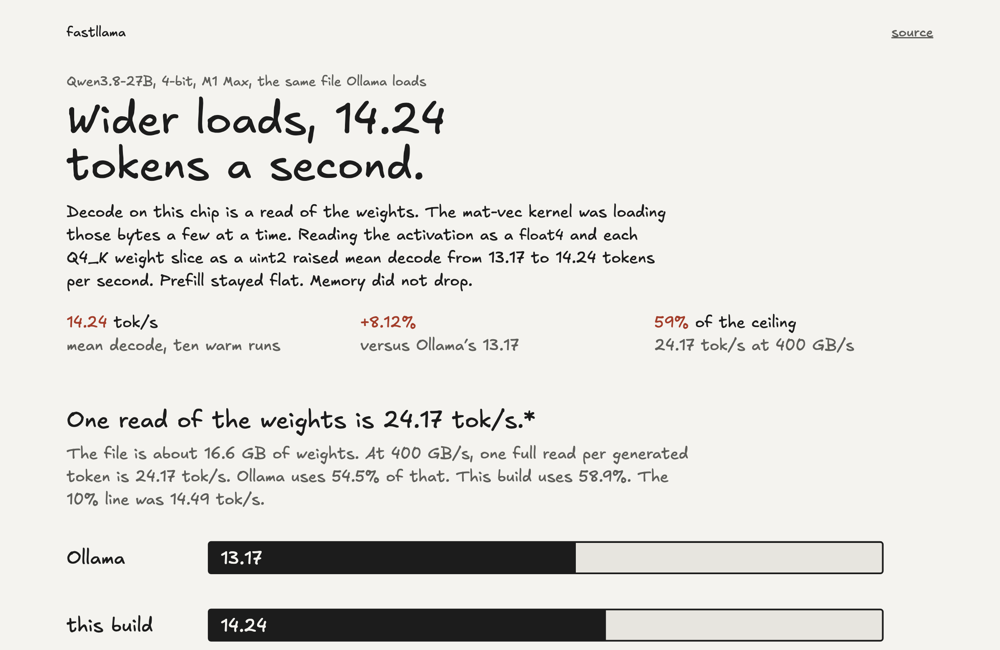

# fastllama

Decode for Qwen3.8-27B on an M1 Max, on the same 4-bit file Ollama loads.

The kept change is wider loads in llama.cpp’s Metal mat-vec kernel, against commit `0f3a71be1`. Mean decode went from 13.17 to 14.24 tokens per second, 59% of a 24.17 tok/s ceiling.* Prefill stayed flat. Memory did not drop.

I tried a lot of other things and nothing else really worked out (a second copy of the Q4 values at 12.01 tok/s, Q4 dot products at 14.10, wider Q6 weight loads at 14.02). Maybe I’ll document everything that failed miserably if anyone is interested.

\* 24.17 is the spec sheet, not a speed I measured. The M1 Max is advertised at 400 GB/s, the weights are 16.6 GB, and 400 divided by 16.6 is about 24 tokens a second if each token were nothing but one read of that file. 14.24 times 16.6 GB is around 240 GB/s, so the reads never got near the advertised number. Bigger loads picked up about one token a second, and the other ideas were slower. A second pass over the weights is a bad excuse: the prompt already reuses them and runs much faster than one read, and keeping an extra copy of the Q4 weights made decode slower. The KV cache on these runs is about 40 MB next to a 16 GB file. I don't know what the other 10 tokens a second are waiting on.

The patch is [`patches/mul_mv-wide-loads.patch`](patches/mul_mv-wide-loads.patch). The writeup is the [site](https://johnkimec.github.io/fastllama/).

